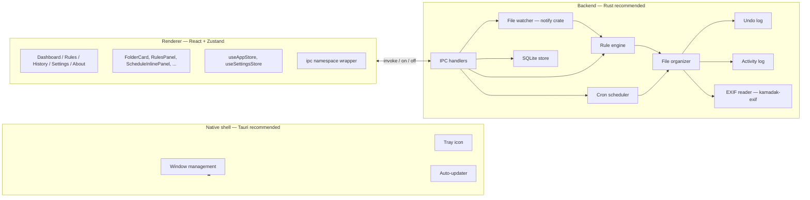
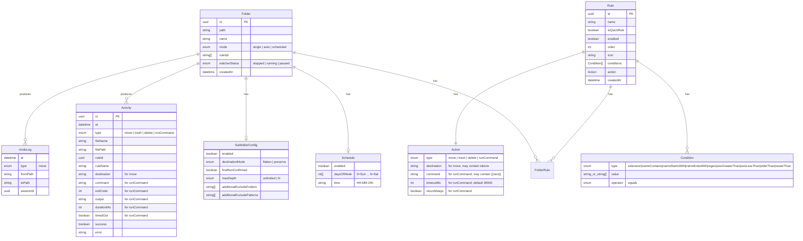
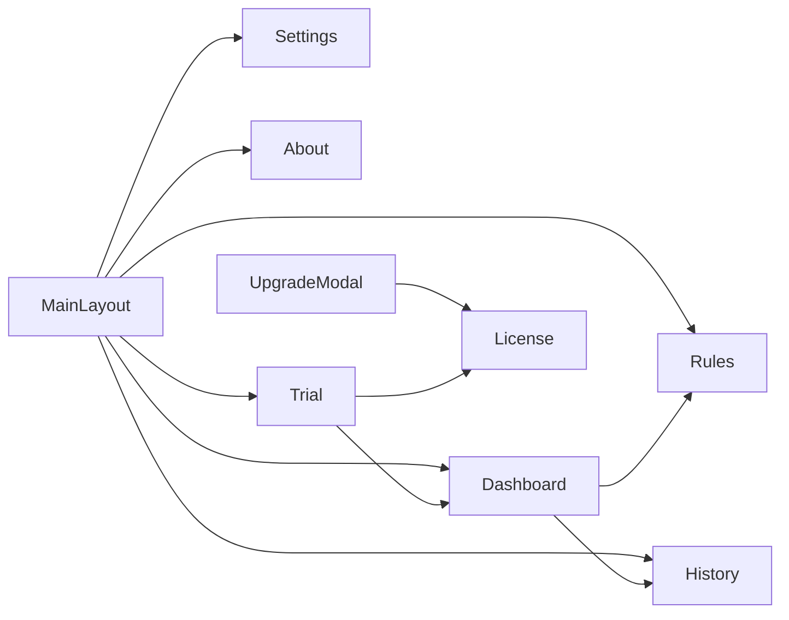
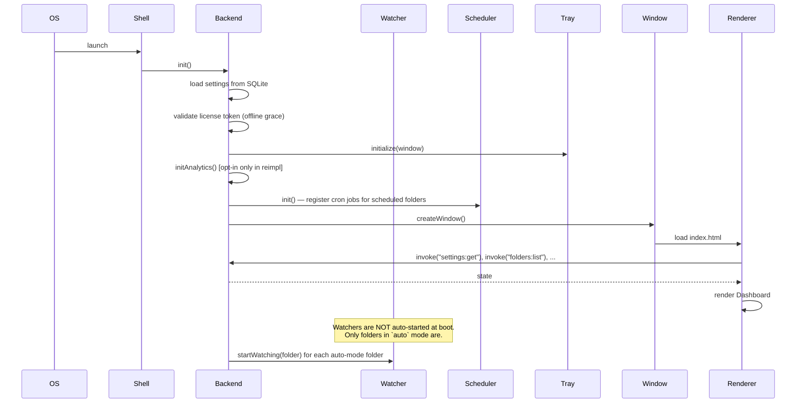
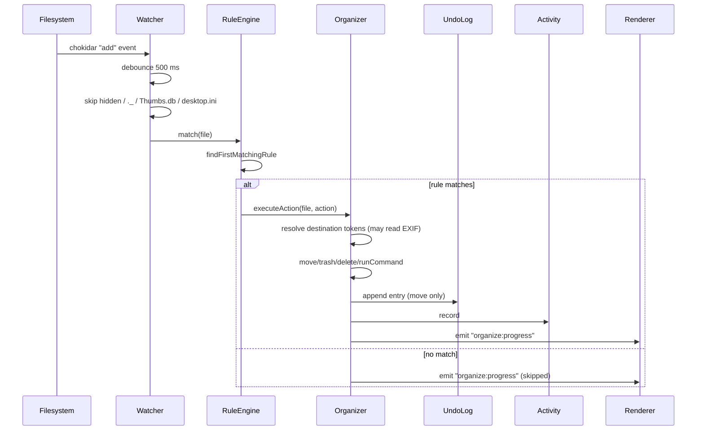
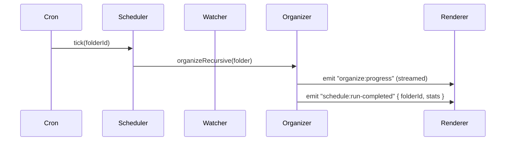
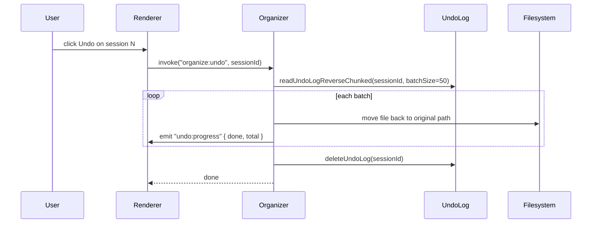
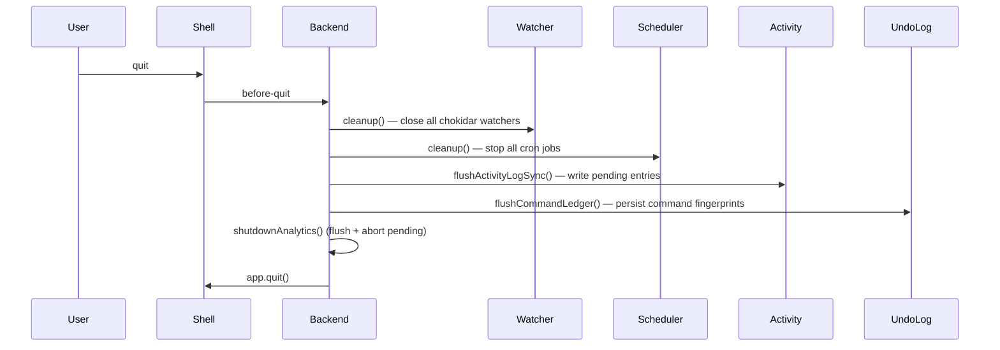

# SPEC.md — File Organizer (clean-room reimplementation)

> **Current implementation scope (local test build).** This is a reference
> specification and long-term product map, not a claim that every described
> service ships today. The current FileGrove build targets Linux and Windows
> and intentionally excludes automatic updates, accounts/licensing, telemetry,
> and public release infrastructure. `README.md`,
> `docs/TESTING_WINDOWS.md`, and `docs/M1_ISSUES.md` are the source of truth
> for what is ready to test now.

> **Product decision.** Scheduled/cron organization described in the observed
> reference behavior is intentionally excluded from FileGrove. FileGrove offers
> Manual and Automatic modes; legacy scheduled folders are migrated to inactive
> Manual mode without discarding their old configuration. References to
> scheduling below document the inspiration product and are not current
> FileGrove requirements.

> **Purpose.** This document is a behavioral specification derived from
> black-box observation of **File Arbor v1.1.2** by Furkan Bagci
> (`https://github.com/furkanbagci34/file-arbor-releases`). It describes
> *what* the application does, *not* how the original source code is
> written. The intent is to enable a clean-room reimplementation under a
> permissive license, without copying any of the original author's code.
>
> Throughout the document, references such as `[FA-NNNN]` point to the
> corresponding observable behavior in the original; they are not source
> citations.

---

## 0. Reference summary

| Field | Value |
|---|---|
| Original product | File Arbor |
| Reference version | 1.1.2 |
| Original author | Furkan Bagci |
| License declared in `package.json` | MIT |
| Source code available upstream | **No** — only binaries are published |
| Distribution channel | GitHub Releases (NSIS installer for Windows) |
| Approximate size (installer) | 80 MB |
| Approximate runtime size (installed) | 290 MB (Electron + Chromium) |
| Reference platforms | Windows (NSIS); code paths exist for macOS and Linux |

The reimplementation should target **Windows, macOS, Linux** from day one,
with a clear preference for a non-Electron stack (see §3).

---

## 1. Product vision

A desktop application that **organizes files automatically** according to
user-defined rules. The user picks one or more "watched folders"; for each
folder they attach one or more rules. When a file appears in a watched
folder (or on a scheduled tick), the rule engine evaluates the file against
the rules in priority order and executes the first matching rule's action
— typically moving the file into a destination folder, optionally built
from a tokenized path template that can include EXIF metadata for photos.

The application lives in the system tray, supports a 3-day Pro trial,
and offers a one-time license purchase to unlock unlimited folders,
rules, conditions, automatic mode, and destructive actions.

### 1.1 Target users

- Photographers with thousand-file dumps from a camera card
- Office workers who want Downloads to self-organize
- Developers who want build artifacts moved out of the way
- Power users who want cron-scheduled batch organization

### 1.2 Non-goals (do not implement)

- Cloud sync — purely local
- Mobile clients
- Real-time collaborative editing
- AI-based content classification (rule-based only)
- File content search

---

## 2. Feature inventory

### 2.1 Core features

| ID | Feature | Description |
|---|---|---|
| F-01 | Folder watching | User adds a folder to watch; new files trigger rule evaluation |
| F-02 | Rule management | CRUD for rules: conditions, action, ordering, enable/disable |
| F-03 | Rule engine | Evaluate file against rule set in priority order; first match wins |
| F-04 | Quick rules | Predefined rules for Images / Documents / Videos / Audio / Archives / Installers |
| F-05 | Manual organize | User clicks "Organize now" — runs once, single-level scan |
| F-06 | Recursive organize | Scans subfolders up to a configurable depth, flattens by default |
| F-07 | Auto mode | Folder watcher fires automatically on every new file |
| F-08 | Scheduled mode | Cron-driven scheduling per folder (days of week + time) |
| F-09 | Conflict behavior | Per-app setting: `rename` / `overwrite` / `skip` |
| F-10 | Undo log | Persistent append-only log per organize session; user can undo the last N moves |
| F-11 | Activity history | Searchable log of every file action (move/trash/delete/runCommand) |
| F-12 | Path templates | Destination paths can include tokens like `{year}/{month}/{camera}` |
| F-13 | EXIF metadata | Photos can be sorted by capture date, camera, lens, ISO, focal length, dimensions |
| F-14 | Run-command action | A rule can execute a shell command with file context variables |
| F-15 | Tray icon | System-tray integration with live status, pause/resume/quit |
| F-16 | Multi-language UI | 8 languages: en, tr, fr, es, de, pt, it, ru |
| F-17 | Onboarding tour | First-run guided walkthrough |
| F-18 | Auto-update | App self-updates from GitHub Releases |
| F-19 | Auto-launch | Optional launch at system login |
| F-20 | Subfolder excludes | Per-folder exclude folders and exclude glob patterns |
| F-21 | Permission prompts | macOS: prompts for folder access; Windows: elevates if needed |
| F-22 | License activation | Activate a license key against a remote server |
| F-23 | Trial | 3-day Pro trial gated by email + HWID verification |
| F-24 | Telemetry | Optional event tracking (PostHog) — **make opt-in in the reimpl.** |

### 2.2 Free-vs-Pro gating (do not replicate; see §11)

The original enforces the following limits on the free plan. **The
reimplementation should ship all features unlocked**, but the table is
included here so the engineering scope is clear.

| Limit | Free | Pro |
|---|---|---|
| Max watched folders | 1 | Unlimited |
| Max custom rules | 2 | Unlimited |
| Max conditions per rule | 1 | Unlimited |
| Allowed condition types | `extension` only | All 9 types |
| Auto mode (real-time) | Disabled | Enabled |
| Scheduled mode | Disabled | Enabled |
| Destructive delete action | Disabled | Enabled |
| Run-command action | Disabled | Enabled |
| Daily file budget | 20 files | Unlimited |
| Subfolder recursive scan | Disabled | Enabled |
| EXIF-based path templates | Disabled | Enabled |
| All non-extension condition types | Disabled | Enabled |

---

## 3. Architecture (recommended for reimplementation)

### 3.1 Reference architecture diagram



### 3.2 Recommended stack

| Layer | Recommendation | Rationale |
|---|---|---|
| Shell | **Tauri 2.x** | ~10 MB bundle vs ~290 MB for Electron; native webview |
| Frontend framework | React 18+ | Same as original; large ecosystem |
| State | Zustand | Same as original; minimal and ergonomic |
| Styling | Tailwind CSS | Same as original; productive |
| Icons | lucide-react | Same as original; permissive license |
| Backend language | **Rust** | Memory-safe, fast, native deps for fs/exif/cron |
| FS watcher | `notify` crate | Cross-platform, mature |
| EXIF | `kamadak-exif` | Pure Rust, no native deps |
| Cron | `tokio-cron-scheduler` | Async, mature |
| Store | **SQLite** (`rusqlite` + `refinery` for migrations) | Durable, queryable, far better than JSON for activity/undo |
| Logging | `tracing` crate | Structured, async |
| Auto-update | `tauri-plugin-updater` | Native to Tauri |
| Telemetry | **None by default** | Make it opt-in via plugin, never on by default |
| i18n | i18next (frontend only) | Same as original; reuse the locale catalogs |
| Tests | `cargo test` + `vitest` + Playwright | Layered testing |

### 3.3 Project layout

```
file-organizer/
├── LICENSE                       Apache 2.0
├── README.md
├── CREDITS.md                    Mentions original inspiration
├── docs/
│   ├── SPEC.md                   This document
│   ├── ARCHITECTURE.md
│   ├── IPC.md                    Channel-by-channel contract
│   ├── RULES.md                  Rule semantics
│   └── I18N.md
├── src-tauri/                    Rust backend
│   ├── Cargo.toml
│   ├── tauri.conf.json
│   └── src/
│       ├── main.rs
│       ├── lib.rs
│       ├── ipc/                  One module per channel group
│       │   ├── mod.rs
│       │   ├── folders.rs
│       │   ├── rules.rs
│       │   ├── files.rs
│       │   ├── watcher.rs
│       │   ├── schedule.rs
│       │   ├── organize.rs
│       │   ├── activity.rs
│       │   ├── settings.rs
│       │   ├── permissions.rs
│       │   └── app.rs
│       ├── domain/
│       │   ├── folder.rs
│       │   ├── rule.rs
│       │   ├── condition.rs
│       │   ├── action.rs
│       │   └── schedule.rs
│       ├── engine/
│       │   ├── matcher.rs        matchCondition equivalent
│       │   ├── planner.rs        computeOrganizePlan equivalent
│       │   └── executor.rs       FileOrganizer equivalent
│       ├── watcher/
│       │   ├── service.rs
│       │   └── filters.rs
│       ├── scheduler/
│       │   └── service.rs
│       ├── storage/
│       │   ├── db.rs
│       │   ├── migrations/
│       │   ├── folders.rs
│       │   ├── rules.rs
│       │   ├── settings.rs
│       │   ├── activity.rs
│       │   └── undo.rs
│       ├── exif/
│       │   └── reader.rs
│       ├── paths/
│       │   ├── tokens.rs         TOKENS equivalent
│       │   └── builder.rs
│       ├── tray/
│       │   └── service.rs
│       └── updater/
│           └── plugin.rs
├── src/                          React frontend
│   ├── main.tsx
│   ├── App.tsx
│   ├── pages/
│   │   ├── Dashboard.tsx
│   │   ├── Rules.tsx
│   │   ├── History.tsx
│   │   ├── Settings.tsx
│   │   ├── About.tsx
│   │   └── Trial.tsx
│   ├── components/
│   │   ├── FolderCard.tsx
│   │   ├── RulesPanel.tsx
│   │   ├── ModeCard.tsx
│   │   ├── ScheduleInlinePanel.tsx
│   │   ├── ExcludeInlinePanel.tsx
│   │   ├── SubfolderInlinePanel.tsx
│   │   ├── OrganizeProgressPanel.tsx
│   │   ├── InspectionPanel.tsx
│   │   ├── SubfolderExplainerModal.tsx
│   │   ├── GuidedTour.tsx
│   │   ├── UndoProgressDialog.tsx
│   │   ├── PermissionErrorDialog.tsx
│   │   └── MainLayout.tsx
│   ├── stores/
│   │   └── useAppStore.ts
│   ├── ipc/
│   │   └── index.ts              Typed wrappers around invoke()
│   ├── i18n/
│   │   ├── index.ts
│   │   └── locales/
│   │       ├── en.json
│   │       ├── es.json
│   │       ├── fr.json
│   │       ├── de.json
│   │       ├── it.json
│   │       ├── pt.json
│   │       ├── ru.json
│   │       └── tr.json
│   ├── lib/
│   │   ├── errors.ts             Error code → message map
│   │   └── theme.ts
│   └── styles/
│       └── index.css
├── crates/                       Optional: extract reusable libs
│   ├── rule-engine/
│   └── path-tokens/
└── tests/
    ├── unit/
    ├── integration/
    └── e2e/
```

---

## 4. Data model

### 4.1 Entities



### 4.2 Settings (global, single-record)

| Key | Type | Default | Notes |
|---|---|---|---|
| `theme` | enum `dark \| light \| system` | `dark` | |
| `language` | enum `en\|tr\|fr\|es\|de\|pt\|it\|ru` | `en` | |
| `launchAtStartup` | bool | `false` | |
| `minimizeToTray` | bool | `true` | |
| `showTrayIcon` | bool | `true` | |
| `notifications` | bool | `true` | OS notifications |
| `conflictBehavior` | enum `overwrite\|rename\|skip` | `rename` | |
| `onboardingCompleted` | bool | `false` | |
| `firstFolderHintShown` | bool | `false` | |
| `subfolderExplainerShown` | bool | `false` | |
| `commandWarningShown` | bool | `false` | |
| `rulesSortOrder` | enum `created\|name` | `created` | |
| `foldersSortOrder` | enum `created\|name` | `created` | |
| `subfolderDefaults.maxDepth` | int | `5` | |
| `subfolderDefaults.excludeFolders` | string[] | `[]` | |
| `subfolderDefaults.excludePatterns` | string[] | `[]` | |

On a fresh install, FileGrove creates no watched folders or rules. Newly added
folders start in Manual mode and stopped; Automatic mode and launch at startup
require separate explicit user choices. Updating an existing installation
preserves its saved folder and startup preferences.

### 4.3 Predefined file-extension buckets

These power the six quick rules. Reuse as-is or expand.

| Bucket | Extensions |
|---|---|
| images | `.jpg .jpeg .png .gif .bmp .webp .svg .ico .heic` |
| documents | `.pdf .doc .docx .xls .xlsx .ppt .pptx .txt .rtf .odt` |
| videos | `.mp4 .mkv .avi .mov .wmv .flv .webm .m4v` |
| audio | `.mp3 .wav .flac .aac .ogg .wma .m4a` |
| archives | `.zip .rar .7z .tar .gz .bz2` |
| executables | `.exe .msi .dmg .app .deb .rpm` |

### 4.4 Default exclude folders (recursive scan)

`node_modules`, `.git`, `.svn`, `.hg`, `dist`, `build`, `.next`, `.turbo`,
`.parcel-cache`, `.cache`, `coverage`, `target`, `.gradle`, `.idea`,
`.vscode`, `vendor`, `Pods`, `.terraform`, `venv`, `$RECYCLE.BIN`,
`System Volume Information`, `Recovery`, `Config.Msi`, `.Trash-1000`,
`SteamLibrary`, plus OS-specific `.Trash-*` glob and
`.DS_Store`/`Thumbs.db`/`desktop.ini` filenames.

The drive-level names are pruned when a whole secondary drive is selected as
a watched root, so the scan never descends into the Recycle Bin, Windows
system metadata, or a Steam library.

---

## 5. Rule engine — formal semantics

### 5.1 Condition evaluation

For each `Condition` against a `FileItem`, evaluate as follows. **All
condition values are case-insensitive.**

| `type` | Semantics |
|---|---|
| `extension` | True iff `file.ext.toLowerCase()` ∈ values (with or without leading dot) |
| `nameContains` | True iff `file.name.toLowerCase()` contains any value |
| `nameStartsWith` | True iff `file.name.toLowerCase()` starts with any value |
| `nameEndsWith` | True iff `file.nameWithoutExt.toLowerCase()` ends with any value |
| `regex` | True iff `new RegExp(values[0], "i").test(file.name)` succeeds |
| `sizeGreaterThan` | True iff `file.size > parseFloat(values[0]) * 1024 * 1024` (MB) |
| `sizeLessThan` | True iff `file.size < parseFloat(values[0]) * 1024 * 1024` (MB) |
| `olderThan` | True iff `file.modifiedAt < now - parseInt(values[0]) days` |
| `newerThan` | True iff `file.modifiedAt > now - parseInt(values[0]) days` |

A **rule matches** iff *all* its conditions match (logical AND).

### 5.2 Plan computation

```
1. Filter rules: r.enabled == true
2. Sort by r.order ascending
3. For each file:
     - Walk rules in order
     - First rule that matches → assign that rule's action
     - No match → action = null (file is skipped)
```

### 5.3 Action types

| `type` | Effect | Side-effects |
|---|---|---|
| `move` | Move file to `destinationDir` (resolved by token expansion) | Records Undo entry; records Activity |
| `trash` | Send to OS trash (`shell.trashItem`) | Records Activity; **no Undo** (OS handles it) |
| `delete` | Permanently delete (`fs.remove`) | Records Activity; **no Undo**; safety: target must be inside watched folder |
| `runCommand` | Execute shell command with substituted variables | Records Activity; tracks fingerprint to avoid reruns unless `rerunAlways=true` |

### 5.4 Conflict resolution (for `move`)

| `conflictBehavior` | If destination file exists |
|---|---|
| `rename` | Append ` (1)`, ` (2)`, … before extension until free |
| `overwrite` | Replace destination |
| `skip` | Leave source in place, mark as success with `skipped: true` |

### 5.5 Path templates (destination tokens)

Destinations may contain `{token}` or `{token:arg}` placeholders. Tokens
are resolved per-file at execution time.

| Token | Resolves to | Fallback when EXIF missing |
|---|---|---|
| `{date}` / `{date:fmt}` | File mtime formatted | n/a |
| `{createddate}` / `{createddate:fmt}` | File ctime formatted | n/a |
| `{year}` `{month}` `{day}` `{time}` | Mtime components | n/a |
| `{monthname}` `{monthshort}` `{weekday}` `{weekdayshort}` | Localized mtime | n/a |
| `{name}` / `{name:0}` `{name:1}` | Filename or filename split part | n/a |
| `{namepart}` / `{namepart:delim}` | Filename piece (picker-based) | n/a |
| `{ext}` / `{ext:upper}` | File extension (no dot) | n/a |
| `{folder}` | Parent folder name | n/a |
| `{exifdate}` `{exifyear}` `{exifweekday}` `{exifweekdayshort}` | EXIF capture date | Falls back to mtime |
| `{camera}` | EXIF model | `""` (token dropped from path) |
| `{lens}` | EXIF lens model | `""` |
| `{iso}` | EXIF ISO | `""` |
| `{focallength}` | EXIF focal length | `""` |
| `{dimensions}` | EXIF image dimensions | `""` |

Date format strings follow a `yyyy-mm-dd`-style mini-DSL (year/month/day
tokens with arbitrary separators). Implement using ICU date formatting in
the frontend and `chrono` in the backend.

### 5.6 Command action — variable substitution

When `action.type == "runCommand"`, the command string is run through
`/bin/sh -c` on Unix or `cmd.exe /d /s /v:on /c` on Windows. Variables
available for substitution:

| Variable | Meaning |
|---|---|
| `{filePath}` | Absolute path to the matched file |
| `{fileName}` | Filename with extension |
| `{folder}` | Parent directory of the file |

The command is also exposed to the child process environment so shell
scripts can read `$FILE_PATH`, `$FILE_NAME`, `$FOLDER` if desired.

Behavior constraints:

- Default timeout: **30 s**. Kill the whole process tree on timeout.
- Max captured output: **1 MB**; truncate with a marker suffix when exceeded.
- **Fingerprinting**: by default, a command runs once per `(ruleId, filePath, command)` triple. Store the fingerprint in a ledger; rerun only if the file changed or the command string changed, unless `rerunAlways=true`.

### 5.7 Folder modes

| Mode | Trigger | Behavior |
|---|---|---|
| `single` | Manual click | Scan root level only, run rules once |
| `auto` | Filesystem event | chokidar/notify watches root with `depth: 0`; debounce 500 ms; on `add`, run rules on that single file |
| `scheduled` | Cron tick | Same scan as `single`, but driven by a cron schedule |

Recursive subfolder scanning is an **opt-in per-folder configuration**
(`subfolders.enabled`) and is incompatible with `auto` mode — only
`single` and `scheduled` modes can recursively scan. The recursive scan
walks the tree up to `maxDepth` (default 5, hard cap `unlimited`), honors
excludes, and throttles progress events to every 250 ms or every 500
files (whichever first). A safety cap of **100 000 files** aborts the
scan and flags `stats.truncated`.

---

## 6. IPC contract

The renderer invokes the backend through namespaced channels. All
`invoke` calls return `{ success: boolean, data?: T, error?: string,
requiresUpgrade?: boolean }` unless documented otherwise.

### 6.1 Files & organize

| Channel | Args | Returns | Notes |
|---|---|---|---|
| `files:scan` | `folderPath` | `{ files, stats }` | Single-level scan |
| `files:scanRecursive` | `folderPath` | `{ files, stats }` | Streamed; emits `scan:progress` |
| `files:preview` | `folderPath` | `{ plan, stats }` | Compute plan without executing |
| `files:previewRecursive` | `folderPath` | `{ plan, stats }` | |
| `files:previewWithDraft` | `folderPath, draftRules` | `{ plan, stats }` | Preview using unsaved rule drafts |
| `files:organize` | `folderPath` | `{ sessionId }` | Streamed; emits `organize:progress`/`done`/`cancelled` |
| `files:organizeRecursive` | `folderPath, opts` | `{ sessionId }` | |
| `organize:cancel` | `sessionId` | `{ success }` | |
| `organize:undo` | `sessionId` | `{ success }` | Replays undo log in reverse; emits `undo:progress` |
| `organize:dismissUndo` | `sessionId` | `{ success }` | Deletes the undo log |

### 6.2 Folders

| Channel | Args | Returns |
|---|---|---|
| `folders:list` | — | `Folder[]` |
| `folders:add` | — | `Folder` (opens OS picker) |
| `folders:remove` | `id` | `{ success }` |
| `folders:updateName` | `id, name` | `Folder` |
| `folders:updateMode` | `id, mode` | `Folder` |
| `folders:assignRules` | `folderId, ruleIds` | `Folder` |
| `folders:unassignRules` | `folderId, ruleIds` | `Folder` |
| `folders:updateSubfoldersConfig` | `id, config` | `Folder` |
| `folders:updateSchedule` | `id, schedule` | `Folder` |
| `folders:selectDestination` | — | `string` (OS picker) |
| `folders:selectExcludeFolder` | `folderId` | `string[]` |
| `folders:selectExcludeFile` | `folderId` | `string[]` |
| `folders:confirmFirstRun` | `id` | `Folder` |
| `folder:select` | — | `string` (OS picker) |

### 6.3 Rules

| Channel | Args | Returns |
|---|---|---|
| `rules:list` | — | `Rule[]` |
| `rules:getByIds` | `ids` | `Rule[]` |
| `rules:create` | `Rule` | `{ success }` |
| `rules:update` | `id, updates` | `{ success }` |
| `rules:delete` | `id` | `{ success }` |
| `rules:toggle` | `id` | `{ success }` (flips enabled) |

### 6.4 Watcher

| Channel | Args | Returns |
|---|---|---|
| `watcher:start` | `folderId` | `{ success }` |
| `watcher:stop` | `folderId` | `{ success }` |
| `watcher:pause` | `folderId` | `{ success }` |
| `watcher:resume` | `folderId` | `{ success }` |
| `watcher:status` | `folderId` | `{ status }` |

Broadcast event `watcher:status-changed` carries `{ folderId, status }`.

### 6.5 Settings

| Channel | Args | Returns |
|---|---|---|
| `settings:get` | — | `Settings` |
| `settings:set` | `partial` | `{ success }` |

### 6.6 Activity

| Channel | Args | Returns |
|---|---|---|
| `activity:list` | `{ limit, offset, filters? }` | `{ items, total }` |
| `activity:delete` | `ids[]` | `{ success }` |
| `activity:clear` | — | `{ success }` |

Broadcast `activity:changed` fires after any mutation.

### 6.7 App & permissions

| Channel | Args | Returns |
|---|---|---|
| `app:getVersion` | — | `string` |
| `app:getIcon` | — | `string` (data URL) |
| `app:minimize` / `app:maximize` / `app:close` | — | — (one-way `send`) |
| `permissions:checkAccess` | `folderPath` | `{ hasAccess, message, error? }` |
| `permissions:openSettings` | — | `{ success }` (opens OS settings) |
| `permissions:isMacOS` | — | `bool` |

### 6.8 Auto-updater

| Channel | Args | Returns |
|---|---|---|
| `updater:check` | — | `{ available, version? }` |
| `updater:download` | — | `{ success }` |
| `updater:install` | — | `{ success }` (relaunches) |
| `updater:getPlatform` | — | `string` |

Broadcasts: `update:available`, `update:progress`, `update:downloaded`.

---

## 7. UI specification

### 7.1 Page map



### 7.2 Page-by-page

#### Dashboard
- Hero: app name, current plan badge, "Add folder" CTA
- Folder grid: one `FolderCard` per watched folder
  - Card shows: name, mode selector (`ModeCard`), watcher status badge, last activity
  - Inline panels: `ScheduleInlinePanel` (if `mode=scheduled`), `ExcludeInlinePanel`, `SubfolderInlinePanel` (if `subfolders.enabled`)
  - Hover actions: rename, remove
- Empty state: friendly prompt + "Add folder" CTA
- First-run hint: one-time tooltip pointing at Add Folder

#### Rules
- Two columns: Quick Rules (read-only chips with "duplicate & edit") + Custom Rules
- Custom rule list: sortable by `order`, filterable by search box, toggle enabled
- Rule editor (modal): name, icon picker, conditions builder (max 10), action builder
- Path-builder UI: click on filename pieces to assemble tokenized destination
- Live preview: "this rule would affect ~N files in folder X"
- Test command button (for `runCommand` action) — runs against a sample file

#### History (Activity)
- Paginated table: timestamp, file, action, rule, success/error
- Filters: by folder, by rule, by success, by date range
- Bulk delete, clear all
- Click row → expand details (for command output, etc.)

#### Settings
- Theme: dark / light / system
- Language: 8 options
- Launch at startup (toggle)
- Minimize to tray (toggle)
- Show tray icon (toggle)
- Notifications (toggle)
- Conflict behavior: rename / overwrite / skip
- Subfolder defaults: maxDepth, exclude folders, exclude patterns
- Rules sort order, Folders sort order
- Check for updates button
- Open data directory button
- Reset onboarding button

#### About
- Version, license, author credit
- Links: website, GitHub, privacy policy
- Acknowledgements (electron, chromium, deps) — adapt to your stack

#### Trial (modal page)
- Email input
- "Send confirmation link" button
- "I confirmed — activate trial" button
- Days-left badge when trial active

#### UpgradeModal (overlay)
- Triggered when user hits a gated limit
- "Upgrade to Pro" CTA → navigates to License page (or external purchase URL)

### 7.3 Global overlays

- `GuidedTour` — react-joyride walkthrough on first launch (4–6 steps)
- `UndoProgressDialog` — shown after organize completes; offers Undo + dismiss
- `PermissionErrorDialog` — macOS-style "Open System Settings" prompt
- `SubfolderExplainerModal` — one-time explanation of recursive scanning

### 7.4 Tray menu

```
File Organizer
─────────────────
Watching: 3 folders
Last: IMG_2024.jpg → Photos/2024/07
Today: 42 files organized
─────────────────
Open App
Pause All
Resume All
─────────────────
Quit
```

Tray icon states: `idle` (gray), `active` (color, when at least one folder in `auto` mode is running), `paused` (yellow).

---

## 8. Lifecycle

### 8.1 Boot sequence



### 8.2 Watcher event → organize (auto mode)



### 8.3 Scheduled organize



### 8.4 Undo flow



### 8.5 Shutdown



---

## 9. Persistence

### 9.1 Storage layout

| Data | Original (electron-store) | Reimpl (recommended) |
|---|---|---|
| Settings | `config.json` (single object) | SQLite table `settings` (k/v) |
| Folders | `config.json` under `folders` key | SQLite table `folders` |
| Rules | `rules.json` (separate store) | SQLite table `rules` |
| Activity | in-memory + append-only file `activity.log` | SQLite table `activity` with index on `at`, `folderId` |
| Undo logs | One file per session in `undo-logs/` dir | SQLite table `undo_entries` partitioned by `sessionId` |
| Command ledger | in-memory `Map` (lost on restart — by design) | in-memory `DashMap` (same) |
| Network log | `network.log` file (5 MB rotation) | `tracing` file appender with rotation |

### 9.2 Data directory layout

```
<userData>/
├── app.db                SQLite database
├── logs/
│   ├── app.log
│   └── network.log
└── cache/
    └── exif/             Optional EXIF cache (path → metadata)
```

`<userData>` should respect platform conventions:
- Windows: `%APPDATA%/<AppName>`
- macOS: `~/Library/Application Support/<AppName>`
- Linux: `~/.local/share/<AppName>` (XDG)

### 9.3 Migration strategy

Use `refinery` or `sqlx migrate`. Schema versioning from day one — even
v0.1.0 should ship with a migrations table. Never mutate data without a
migration.

---

## 10. Security considerations

### 10.1 Path safety

- `move` destination must be **outside** the watched folder root (otherwise the file would re-trigger rules in `auto` mode). Validate and reject with `INVALID_DESTINATION`.
- `move` destination must not escape via `..` traversal. Validate and reject with `INVALID_DESTINATION_TRAVERSAL`.
- `move` destination must not be a protected system path (`/`, `/System`, `C:\Windows`, etc.). Reject with `INVALID_DESTINATION_PROTECTED`.
- On Windows, a whole secondary drive root may be watched, but the system drive root (`%SystemDrive%`, normally `C:`) stays protected and is rejected with `WATCHED_FOLDER_PROTECTED`. Destination directories remain protected on every drive.
- `delete` target must be **inside** the watched folder root. Reject with `WATCHED_FOLDER_PROTECTED` otherwise.
- All path validation uses canonicalized absolute paths.

### 10.2 Command execution

- Run with the **current user's** privileges — never elevate.
- On Windows, force UTF-8 codepage (`chcp 65001`) before executing.
- Always kill the entire process tree on timeout (use `windows-kill-tree` or `pgid`-based kill on Unix).
- Capture at most 1 MB of stdout+stderr to avoid memory exhaustion.
- Show a one-time warning dialog before the user saves the first `runCommand` rule.

### 10.3 Filesystem event filtering

Always ignore:
- Hidden files (starting with `.`)
- macOS metadata files (`._*`, `Icon\r`)
- `Thumbs.db`, `desktop.ini`, `.DS_Store`
- Files within excluded folders / matching excluded globs

### 10.4 Auto-update

- Verify update signature before installing (Tauri updater supports this).
- Never auto-install without user consent — prompt and let them choose.

### 10.5 Telemetry (reimpl policy)

- **Default off.** Never collect anything unless the user opts in.
- If implemented, use a self-hostable endpoint (PostHog self-host, Plausible, or a custom event API).
- Document exactly what is collected in `docs/PRIVACY.md`.
- Provide a "Export my data" and "Delete my data" button.

---

## 11. Licensing model for the reimplementation

### 11.1 Recommendation: **fully open-source, no paywall**

The reimplementation should ship **all features unlocked**. Rationale:

1. **Simplicity.** No license server, no HWID tracking, no token signing infrastructure to maintain.
2. **Community.** Open-source users expect full features; gating creates friction and forks.
3. **Sustainability alternatives.** Use GitHub Sponsors, OpenCollective, or a "supported builds" model (free source, paid pre-built binaries with auto-update) — like Obsidian or many BSL projects.

### 11.2 Recommended license

**Apache 2.0** for the codebase. Reasons over MIT:

- Explicit patent grant protects contributors and users.
- Requires preserving `NOTICE` file — slight attribution guarantee.
- Compatible with most downstream uses.

Add a `NOTICE` file at the repo root:

```
File Organizer
Copyright 2026 <Your Name>

This product includes software developed as a clean-room reimplementation
inspired by File Arbor (https://github.com/furkanbagci34/file-arbor-releases).
No code from the original product was copied.
```

### 11.3 What to delete from the original design

When implementing, **omit** these original features entirely:

- License activation (`license:activate`, `license:verify`, `license:deactivate`, `license:getInfo`)
- Trial flow (`trial:request`, `trial:activate`, `trial:eligibility`)
- `UpgradeModal` component
- HWID generation (`node-machine-id`)
- License token signing/verification
- All `FREE_PLAN_LIMITS` enforcement (`getActiveResources` logic)
- PostHog telemetry (replace with opt-in plugin if at all)
- `usage:getStatus` (daily file budget tracking)
- All i18n strings under the `license.*`, `trial.*`, and `upgrade.*` namespaces

The result is a much smaller, cleaner codebase — easily 30 % fewer IPC
channels and 20 % fewer UI components.

---

## 12. i18n

### 12.1 Supported languages

| Code | Name | Native |
|---|---|---|
| `en` | English | English |
| `tr` | Turkish | Türkçe |
| `fr` | French | Français |
| `es` | Spanish | Español |
| `de` | German | Deutsch |
| `pt` | Portuguese | Português |
| `it` | Italian | Italiano |
| `ru` | Russian | Русский |

### 12.2 Namespace structure

The original groups strings by feature:

- `common.*` — buttons, statuses, shared labels
- `dashboard.*` — main page
- `folders.*` — folder management
- `rules.*` — rule editor and list
- `activity.*` — history
- `settings.*` — settings page
- `tray.*` — tray menu strings
- `notifications.*` — OS notification strings
- `permissions.*` — permission prompts
- `errors.*` — error code → message map
- `onboarding.*` — guided tour steps

For the reimpl, drop `license.*`, `trial.*`, `upgrade.*`.

### 12.3 Pluralization

i18next handles plurals via `_one`/`_other` suffixes (and `_zero` for
Russian). Examples observed:

- `filesOrganized: "{{count}} file(s) organized"`
- `daysLeft: "Days left: {{count}}"` / `lastDay: "Last day"`
- `moreExtensions: "{{first}} and {{count}} more"`

Reuse this pattern; keep the locale catalogs JSON-based.

---

## 13. Error code reference

The original defines ~25 error codes. The reimpl should keep them stable
for UX continuity.

| Code | Meaning |
|---|---|
| `FOLDER_NOT_FOUND` | Folder ID does not exist |
| `NO_RULES_ASSIGNED` | Folder has no rules attached |
| `NO_RULES_ENABLED` | All attached rules are disabled |
| `SUBFOLDERS_NOT_ENABLED` | Recursive scan requested but disabled on folder |
| `SUBFOLDERS_REQUIRE_MANUAL_MODE` | Recursive scan requested in `auto` mode (not allowed) |
| `EXCLUDE_OUTSIDE_ROOT` | Exclude path is outside the watched root |
| `AUTO_MODE_CONFLICTS_WITH_SUBFOLDERS` | Tried to enable auto + subfolders simultaneously |
| `INVALID_DESTINATION` | Destination path is empty or invalid |
| `INVALID_DESTINATION_TRAVERSAL` | Destination contains `..` traversal |
| `INVALID_DESTINATION_PROTECTED` | Destination is a protected system path |
| `INVALID_DESTINATION_TOKEN` | Destination contains an unknown token |
| `INVALID_DESTINATION_TOKEN_FORMAT` | Token has malformed syntax |
| `WATCHED_FOLDER_PROTECTED` | Tried to delete a file outside the watched root |
| `WATCHED_FOLDER_INVALID` | Watched folder path no longer exists |
| `ORGANIZE_ALREADY_RUNNING` | A session is already in progress for this folder |
| `INVALID_SESSION_ID` | Undo/cancel referenced an unknown session |
| `LOG_NOT_FOUND` | Undo log file missing |
| `NOT_FOUND` | Generic 404 |
| `USER_CANCELED_FOLDER_SELECT` | User closed the OS folder picker |
| `DELETE_FAILED` / `DELETE_PRO_ONLY` | Delete action failed (drop the PRO variant in reimpl) |
| `COMMAND_PRO_ONLY` / `COMMAND_UNAVAILABLE` / `COMMAND_TIMED_OUT` / `COMMAND_EXIT_N` | runCommand lifecycle errors |
| `INVALID_LICENSE_FORMAT` | Drop in reimpl |
| `TRIAL_INELIGIBLE_DEVICE` | Drop in reimpl |

---

## 14. Testing strategy

### 14.1 Unit tests
- Rule matcher: every condition type, every operator, case-insensitivity, regex errors
- Token resolver: every token, fallback behavior, format strings
- Conflict resolution: rename numbering, overwrite, skip
- Cron expression builder: all day combinations, edge cases (midnight, all-days)
- Path safety: traversal attempts, protected paths, outside-root

### 14.2 Integration tests
- Watcher → engine → organizer → undo round-trip
- Scheduler firing at a synthetic time
- Activity log pagination and filtering
- Settings change propagating to running watchers

### 14.3 E2E tests (Playwright / Tauri WebDriver)
- Add folder, add rule, organize, verify file moved, undo, verify file restored
- Multi-folder, multi-rule scenarios
- Recursive scan with excludes
- Onboarding tour completion
- Tray menu interactions

### 14.4 Property-based tests
- Rule matcher: for any file + any rule, the result is deterministic
- Token resolver: for any path template, the result never contains unresolved `{...}` (tokens either resolve or are dropped)

---

## 15. Milestones (recommended roadmap)

| Milestone | Scope | Est. effort (1 dev, half-time) |
|---|---|---|
| **M0 — Spec freeze** | This document reviewed and frozen | 1 week |
| **M1 — Skeleton** | Tauri + React + SQLite scaffolding; CI; empty UI shell with MainLayout + navigation | 1 week |
| **M2 — Domain & storage** | SQLite schema + migrations; CRUD for folders, rules, settings | 2 weeks |
| **M3 — Rule engine** | Condition matcher, plan computation, action executor (move/trash/delete), path tokens (non-EXIF) | 3 weeks |
| **M4 — Watcher** | notify-based watcher service, auto-mode integration, debouncing, filters | 2 weeks |
| **M5 — Manual organize** | `files:scan`, `files:preview`, `files:organize` IPC + Dashboard UI | 2 weeks |
| **M6 — Recursive scan** | Subfolder walker with excludes, progress streaming, safety caps | 2 weeks |
| **M7 — Schedule** | Cron service, ScheduleInlinePanel UI, scheduled-mode folder integration | 2 weeks |
| **M8 — Undo & activity** | Undo log, undo UI, activity history page with filters | 2 weeks |
| **M9 — EXIF** | kamadak-exif integration, EXIF tokens, photo-sorting quick rule | 1 week |
| **M10 — Run-command** | Command executor with timeout, fingerprinting, test UI | 1 week |
| **M11 — Tray** | Tray icon states, context menu, pause/resume/quit | 1 week |
| **M12 — i18n** | 8 languages; reuse catalogs from original minus `license/trial/upgrade` namespaces | 1 week |
| **M13 — Onboarding & polish** | Guided tour, subfolder explainer, first-run hints, error dialogs | 1 week |
| **M14 — Auto-update** | Tauri updater plugin + signing | 1 week |
| **M15 — Testing & docs** | E2E suite, user guide, dev docs, privacy doc | 2 weeks |
| **M16 — v0.1.0 release** | GitHub Release with signed installers for Win/macOS/Linux | 1 week |
| **Total** | | **~25 weeks (~6 months)** |

For a faster MVP, drop M9 (EXIF), M10 (run-command), M12 (i18n: ship en-only) — that gets you to **~4 months**.

---

## 16. Open questions (resolve before M1)

1. **App name.** Must be distinct from "File Arbor" to avoid trademark issues. Suggestions: `TreeSort`, `FileGrove`, `Arboreal`, `Twig`, `Sortfold`.
2. **License server or fully free?** Strong recommendation: fully free. If you want a "supported builds" tier, decide now to architect for it.
3. **Cross-platform from day one?** Tauri makes this nearly free; recommend yes.
4. **Mobile companion?** Out of scope per §1.2 — confirm.
5. **Plugin system?** Consider whether rules should be extensible via user plugins (Lua? WASM?). Adds complexity but huge power-user appeal. Recommend: no for v0.1, design with extension point in mind.
6. **Cloud sync?** Out of scope per §1.2 — confirm.
7. **Telemetry policy.** Default off? Self-hosted PostHog? None at all? Recommend: none at all for v0.1, revisit if user base grows.
8. **Branding assets.** Need a logo, color palette, icon set. Lucide + a custom wordmark is enough to start.

---

## 17. References

- Original product (binary releases only): `https://github.com/furkanbagci34/file-arbor-releases`
- Original author: `furkanbagci34`
- Reference version analyzed: v1.1.2
- Recommended reimplementation stack: Tauri 2.x, React 18, Zustand, Tailwind, Rust, SQLite, notify, kamadak-exif, tokio-cron-scheduler
- Recommended license: Apache 2.0

---

*End of SPEC.md. This document is released under CC0 1.0 (public domain).*
